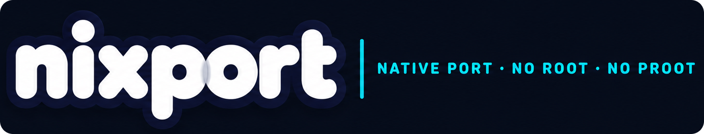
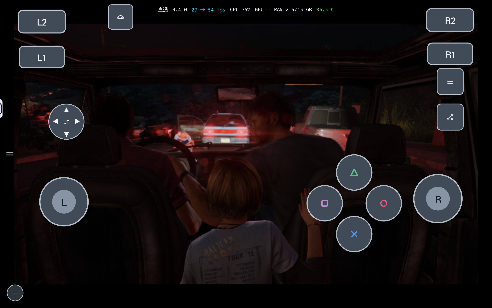
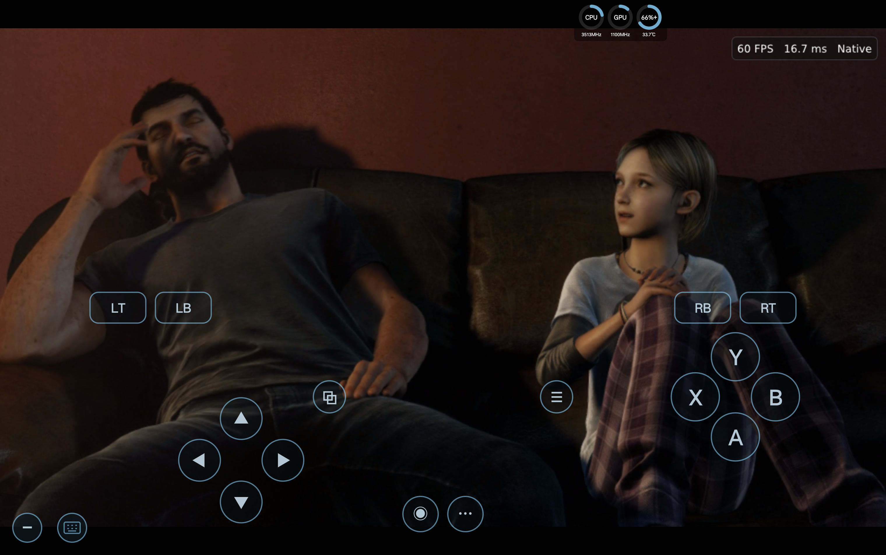
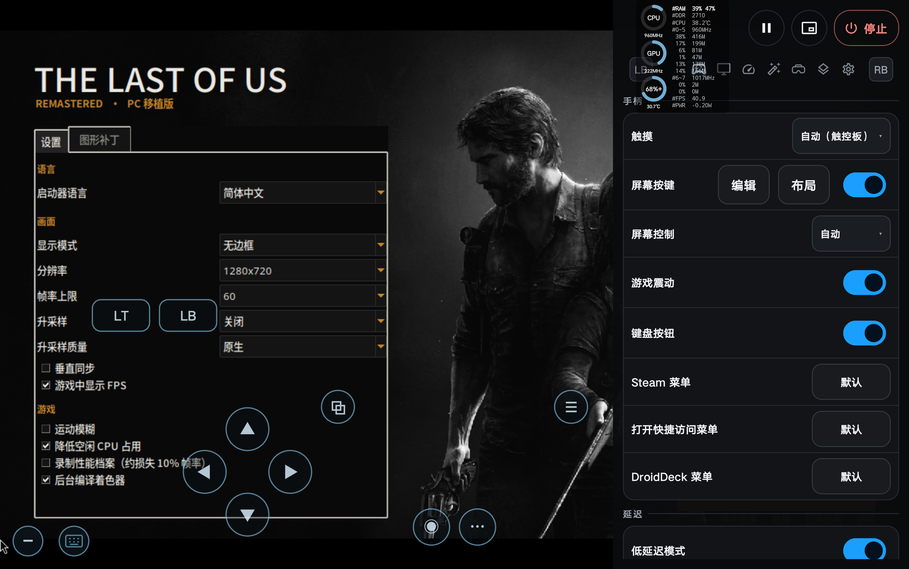
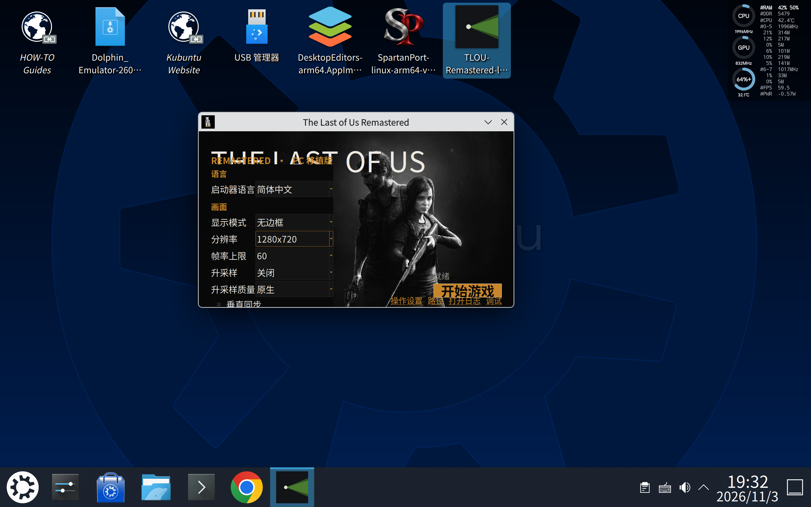

  

# The Last of Us Remastered — Experimental ARM64 Android port

English | [简体中文](README.zh.md)

An experimental Android port of **The Last of Us Remastered**, based on
[ravencaio/tlou-remastered-pc v0.1.4](https://github.com/ravencaio/tlou-remastered-pc/tree/v0.1.4).
The development build has run on one Android device using **nixport**, **DroidDeck** and
**DroidSpaces**. **FEXCore** translates the game's x86-64 code, and the **shadPS4 video core**
translates its graphics to Vulkan.

> **Experimental — in preparation and debugging.** The ARM64 implementation is being prepared
> for a future open-source release. No source-release date has been announced. The `arm` branch
> starts from upstream **v0.1.4** (`eebf981`) and currently adds only
> documentation and image assets. The Android instructions and results below describe a separate
> development build; this branch cannot yet be used to build the Android port.

> **No game files are included.** You need your own decrypted PS4 game dump and its update.
> This project is not affiliated with or endorsed by Sony Interactive Entertainment or
> Naughty Dog. The Last of Us is a trademark of Sony Interactive Entertainment.

## Contents

- [Development screenshots](#development-screenshots)
- [Android and upstream](#android-and-upstream)
- [Android development status](#android-development-status)
- [Tested environments](#tested-environments)
- [Requirements for Android](#requirements-for-android)
- [Installing an Android Port package](#installing-an-android-port-package)
- [Controls and settings](#controls-and-settings)
- [Performance and known limitations](#performance-and-known-limitations)
- [Source and builds](#source-and-builds)
- [Credits](#credits)

## Development screenshots

**Test device:** Lenovo Legion Y700 · Snapdragon 8 Elite.

These screenshots show the TLOU development build on the test device: in-game scenes and
both mobile and desktop launcher views. A frame-rate overlay in a single screenshot is not a
gameplay benchmark.

| nixport gameplay | DroidDeck gameplay |
|---|---|
|  |  |

| Launcher interface and patch support | Running in a DroidSpaces container |
|---|---|
|  |  |

**DroidDeck currently experiences crashes; nixport is recommended for playing.**

## Android and upstream

On Windows, the original PS4 x86-64 game code runs directly on the PC's CPU. On an ARM64
Android device, the development build executes that code through an embedded **FEXCore JIT**.
The game-specific runtime and GPU renderer are compiled for ARM64. In the nixport setup, they use
its **glibc Linux runtime**, rather than an Android Bionic build of the game.

| Part | Upstream v0.1.4 | nixport development build |
|---|---|---|
| Platform | Windows x86-64 | ARM64 Android through nixport |
| Game CPU code | Runs directly on an x86-64 CPU | Translated by FEXCore JIT |
| Graphics | shadPS4 → Vulkan | shadPS4 → Vulkan, using the Android driver |
| Distribution | Windows release ZIP | nixport Port ZIP: manifest, ARM64 AppImage and virtual key layout |
| Input | SDL3 gamepad, keyboard and mouse | Host-provided on-screen gamepad; other input needs device-specific validation |
| System environment | Bundled Windows dependencies | nixport rootfs, glibc, display/audio/input bridges and GPU drivers |

The Android work includes ARM64 fiber switching, runtime memory validation, startup fixes,
Port packaging and a device-oriented launcher. These changes are not part of this
documentation-only branch yet. **AOT is not used in the current Android development build.**

## Android development status

Menus and actual gameplay have rendered on an Android device, and the on-screen gamepad has
been used in-game. This is an experimental port: it has not been validated through the full game.

- **Game tested:** CUSA00559 with update **01.11**. Upstream targets CUSA00552 with update 1.11;
  compatibility with one title ID does not establish compatibility with the other.
- **Device tested:** Lenovo TB322FC, Snapdragon SM8750P, Adreno 830, Android 16, approximately
  16 GB RAM and 4 KB memory pages.
- **Performance reference:** an earlier development build recorded **24.9–28.8 FPS** over a
  45-second gameplay sample with the game capped at **30 FPS**. This was not a benchmark of the
  v0.1.4-based package, a full playthrough or a sustained thermal test.
- **Still under validation:** external controllers and reconnect behavior, long sessions,
  save/load coverage, other devices and sustained power consumption.
- **Graphics patches:** mobile effect-reduction patches are experimental. A visible toggle is
  not proof that a patch was applied; compatibility depends on the actual executable and
  original bytes, not only the title ID or update number.

## Tested environments

The following three environments were reported to run the development build successfully on the
**same Android device**: Lenovo TB322FC (Snapdragon SM8750P, Adreno 830, Android 16, approximately
16 GB RAM). These are initial run results, not full-playthrough or cross-device compatibility claims.

| Android host | Linux environment | Result |
|---|---|---|
| **nixport** | nixport's ARM64 Linux runtime | Runs successfully |
| **DroidDeck** | Arch Linux via PRoot | Runs, but crashes have been observed |
| **DroidSpaces** | Ubuntu 26 with the KDE desktop | Runs successfully |

The setup and packaging steps below describe the **nixport** environment; DroidDeck and
DroidSpaces use their respective Linux environments and may require different setup.

## Requirements for Android

- An ARM64 Android device. Android 12 or newer, Snapdragon/Adreno hardware and at least 12 GB
  RAM are the current targets; testing so far covers the device listed above, not every device
  meeting those specifications. Devices with 16 KB memory pages have not been validated.
- For the nixport setup: the **nixport host**, which supplies the rootfs, glibc, session and display/audio/input
  services. Install it from the [nixport releases](https://github.com/zFitness/nixport/releases).
- A working **Vulkan 1.3** driver supported by the host and device. Turnip is an option on
  compatible Adreno devices; driver choice is device-specific.
- Your own decrypted game folder, including `eboot.bin`, its required modules and game data,
  together with update **01.11**. Keep the base game and update available to the launcher.
- Storage for your game, update, Port package, shader cache and saves.

## Installing an Android Port package

The Android port is experimental and still in preparation and debugging. This README does
not announce a public Android release or provide a development-package download. Any future
public release will be announced on this fork's
[Releases page](https://github.com/zFitness/tlou-remastered-pc/releases).
An upstream Windows ZIP cannot be imported as the Android Port.

If you have an Android development package named **`tlou-port.zip`**:

1. Install [nixport](https://github.com/zFitness/nixport/releases) and let its initial runtime setup finish.
2. Copy `tlou-port.zip` to the device, for example into **Download**. Keep it as a ZIP for import.
3. In nixport, open **Library → Import Port package** and select the ZIP.
4. Open the imported **The Last of Us Remastered** entry and start **TLOU Launcher**.
5. Choose your game and update folders in the launcher, save the settings and press **Play**.

The package includes `port.json`, `TLOU-Remastered-arm64.AppImage` and `virtualkeys.json`.
The host imports the package and installs the game's default on-screen controls.
The game files themselves remain separate and are not included in the Port.

When updating, close the running Port before importing a replacement. Back up your saves and
settings first, and retain the previous working package for rollback.

## Controls and settings

The Android development package uses nixport's on-screen gamepad, including both sticks,
the directional pad, face buttons and shoulder buttons. External controller compatibility
must be checked separately; working touch controls do not establish USB/Bluetooth or reconnect
support on every device.

Start with **720p output**, **30 FPS**, and upscaling disabled. These are development defaults,
not a promise of a locked frame rate. Change one setting at a time when comparing performance.

The Port's data stays in its host-managed storage home. In the current development package,
settings are under `home/tlou/`, saves and shader cache under
`home/tlou/analysis/tlou-user/`, and the game log is `home/tlou/analysis/tlou/boot.log`.
Use the host's log/report tools when reporting problems; do not delete your data to troubleshoot
an input or rendering issue.

## Performance and known limitations

- Shader compilation can cause pauses when first entering an area.
- Performance depends on the scene, driver, game build, shader cache and device temperature.
  Menu FPS and the host's display refresh rate do not describe gameplay FPS.
- A 30 FPS cap can improve pacing. It does not establish that every scene sustains 30 FPS.
- Touch input has temporarily stopped responding in one development session and recovered in
  a new process. The cause is unresolved; it has not been established as a graphics-patch issue.
- Image quality, audio, progression and save/load behavior still need broader gameplay testing.
- There is no verified sustained power reduction or battery-life claim for this port.
- Upstream desktop DLSS/FSR features and performance figures do not establish Android feature
  support or performance.

For a useful report, include the Port version, device/Android version, GPU driver, title ID and
update, scene or save, settings, enabled patches and the game log. Never upload game files.

## Source and builds

The ARM64 runtime and packaging implementation is being prepared and debugged and **will be
open-sourced in the future**. No source-release date has been announced.

The `arm` branch is based on the clean upstream **v0.1.4** source and currently adds only this
README and screenshot assets. The upstream code retains its existing license.
There is **no Android source-build procedure available from this branch yet**.

## Credits

- [ravencaio/tlou-remastered-pc](https://github.com/ravencaio/tlou-remastered-pc): the upstream
  TLOU PC port and v0.1.4 baseline.
- [FEX](https://github.com/FEX-Emu/FEX): x86-64 translation used by the Android development build.
- [nixport](https://github.com/zFitness/nixport): Android host and Port environment.
- [SpartanPort](https://github.com/FelipePrado0/SpartanPort): port lineage and reference for the
  ARM64 Port workflow.
- The shadPS4 team and the runtime/third-party authors credited in the [upstream README](https://github.com/ravencaio/tlou-remastered-pc).

Licensed under **GNU GPL v2 or later**; see [LICENSE](LICENSE). Third-party components retain
their own licenses. This documentation-only branch does not contain the separate ARM64 implementation.
