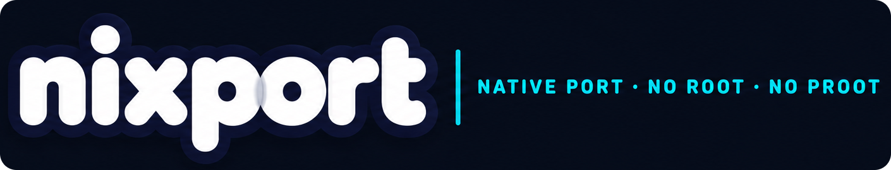
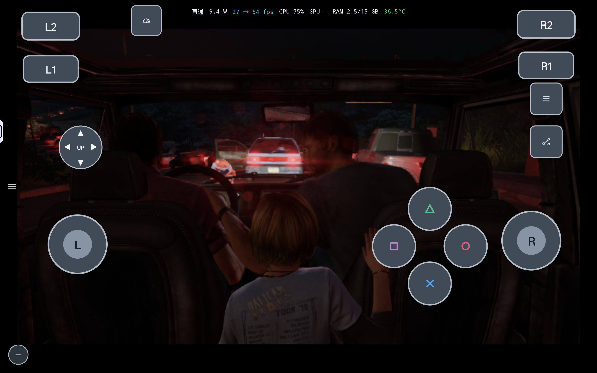
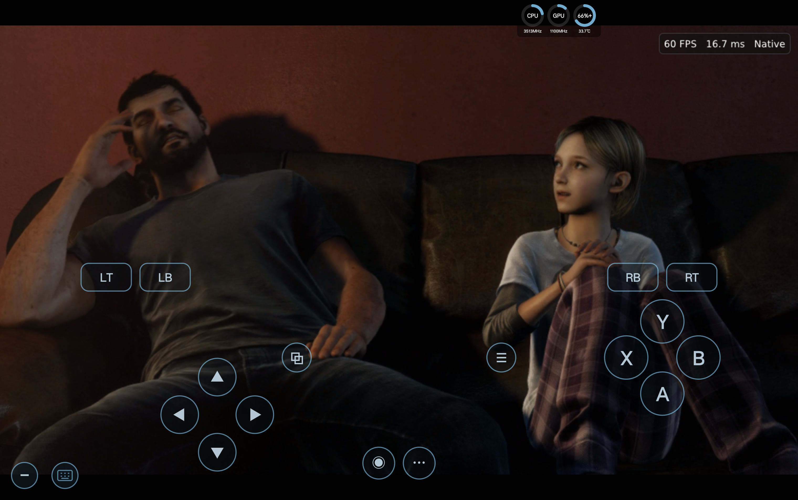
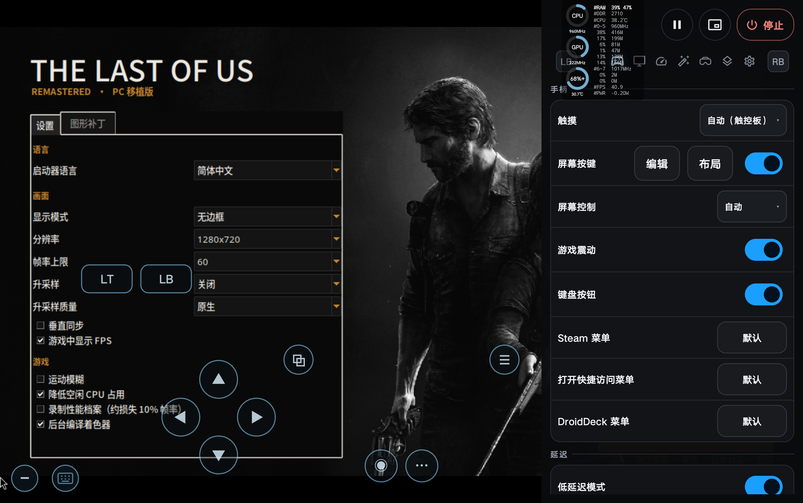
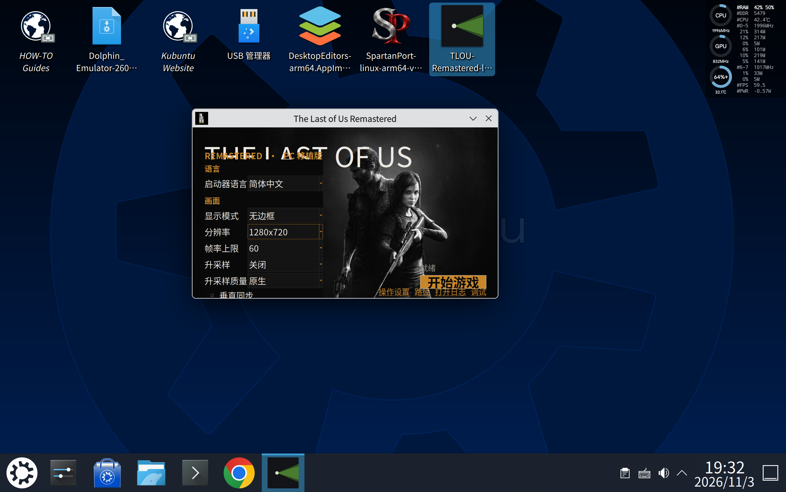

<p align="center">
  <a href="https://github.com/zFitness/nixport">
    
  </a>
</p>

# The Last of Us Remastered — 实验性 ARM64 Android 移植

[English](README.md) | 简体中文

这是基于 [ravencaio/tlou-remastered-pc v0.1.4](https://github.com/ravencaio/tlou-remastered-pc/tree/v0.1.4) 的《最后生还者：重制版》实验性 Android 移植。开发版本已在同一台 Android 设备上通过 **nixport**、**DroidDeck** 和 **DroidSpaces** 运行。游戏的 x86-64 代码由 **FEXCore** 翻译，图形由 **shadPS4 video core** 转换为 Vulkan。

> **实验项目，仍在准备和调试中。** ARM64 实现仍在准备，**后续将开源**，目前尚未公布源码发布时间。`arm` 分支基于上游 **v0.1.4**（`eebf981`），目前只增加文档与图片资源。下文的 Android 操作说明和运行结果来自独立开发版本；本分支目前无法构建 Android 移植版。

> **本仓库不包含游戏文件。** 你需要自行准备已解密的 PS4 游戏及其更新文件。本项目与 Sony Interactive Entertainment 和 Naughty Dog 没有隶属或授权关系。The Last of Us 是 Sony Interactive Entertainment 的商标。

## 目录

- [开发版本截图](#开发版本截图)
- [Android 版本与上游的区别](#android-版本与上游的区别)
- [Android 开发状态](#android-开发状态)
- [已测试的运行环境](#已测试的运行环境)
- [Android 环境要求](#android-环境要求)
- [安装 Android Port 包](#安装-android-port-包)
- [游戏本体与更新补丁的目录结构](#游戏本体与更新补丁的目录结构)
- [操作与设置](#操作与设置)
- [性能与已知限制](#性能与已知限制)
- [源码与构建](#源码与构建)
- [致谢](#致谢)

## 开发版本截图

**测试设备：联想 Y700 · 骁龙 8 Elite**

以下截图来自测试设备上的 TLOU 开发版本，展示游戏画面以及移动端和桌面环境中的启动器。单张截图中的帧率读数不能作为游戏性能基准。

| nixport 游玩 | DroidDeck 游玩 |
|---|---|
|  |  |

| 启动器样式／补丁支持 | DroidSpaces 容器环境运行 |
|---|---|
|  |  |

**DroidDeck 当前运行时会出现闪退，建议使用 nixport 游玩。**

## Android 版本与上游的区别

Windows 上，原始 PS4 x86-64 游戏代码直接在 PC CPU 上运行。ARM64 Android 开发版本通过内嵌的 **FEXCore JIT** 执行这些代码；游戏运行时与 GPU 渲染器编译为 ARM64。使用 nixport 时，它们运行在 nixport 提供的 **glibc Linux 运行环境**中，而不是 Android Bionic 游戏构建。

| 项目 | 上游 v0.1.4 | nixport 开发版本 |
|---|---|---|
| 平台 | Windows x86-64 | 通过 nixport 在 ARM64 Android 上运行 |
| 游戏 CPU 代码 | 直接在 x86-64 CPU 上运行 | 由 FEXCore JIT 翻译 |
| 图形 | shadPS4 → Vulkan | shadPS4 → Vulkan，使用 Android 驱动 |
| 分发 | Windows 发布 ZIP | nixport Port ZIP：清单、ARM64 AppImage 和虚拟按键布局 |
| 输入 | SDL3 手柄、键盘、鼠标 | 宿主提供的屏幕手柄；其他输入需按设备验证 |
| 系统环境 | 随包提供 Windows 依赖 | nixport rootfs、glibc、显示／音频／输入桥接及 GPU 驱动 |

Android 工作包含 ARM64 fiber 切换、运行时内存校验、启动修复、Port 打包和面向设备的启动器。这些修改目前尚不在本纯文档分支中。**当前 Android 开发版本不使用 AOT。**

## Android 开发状态

Android 设备上已经显示菜单和实际游戏画面，屏幕手柄也已用于游戏。本移植仍处于实验阶段，尚未完成全流程验证。

- **测试游戏：** CUSA00559，更新 **01.11**。上游针对 CUSA00552 和更新 1.11；一个标题 ID 可用不代表另一个也兼容。
- **测试设备：** 联想 TB322FC、Snapdragon SM8750P、Adreno 830、Android 16，约 16 GB 内存，内存页大小 4 KB。
- **性能参考：** 较早的开发版本在游戏内限制 **30 FPS** 时，一段 45 秒的游戏采样记录了 **24.9–28.8 FPS**。这不是基于 v0.1.4 的包的基准测试、全流程测试或持续温度测试。
- **仍待验证：** 外接手柄和重新连接、长时间运行、存档读写覆盖、其他设备及持续功耗。
- **图形补丁：** 移动端去特效补丁属于实验功能。看到开关不代表补丁已经应用；兼容性取决于实际可执行文件和原始字节，而不仅是标题 ID 或更新号。

## 已测试的运行环境

以下三种环境均据实际运行反馈，在**同一台 Android 设备**上成功运行开发版本：联想 TB322FC（Snapdragon SM8750P、Adreno 830、Android 16、约 16 GB 内存）。这是初步运行结果，不代表已经通关或验证其他设备。

| Android 宿主 | Linux 环境 | 结果 |
|---|---|---|
| **nixport** | nixport ARM64 Linux 运行环境 | 运行成功 |
| **DroidDeck** | PRoot / Arch Linux | 可运行，已出现闪退 |
| **DroidSpaces** | Ubuntu 26 / KDE 桌面 | 运行成功 |

下方的安装和打包步骤针对 **nixport**；DroidDeck 和 DroidSpaces 使用各自的 Linux 环境，配置步骤可能不同。

## Android 环境要求

- ARM64 Android 设备。目前目标为 Android 12 或更新版本、Snapdragon／Adreno 硬件和至少 12 GB 内存；实际测试仅覆盖上述设备，不能代表所有满足要求的设备。16 KB 内存页设备尚未验证。
- 使用 nixport 时，需要 **nixport 宿主**提供 rootfs、glibc、会话以及显示／音频／输入服务。可从 [nixport Releases](https://github.com/zFitness/nixport/releases) 安装。
- 宿主与设备支持的 **Vulkan 1.3** 驱动。兼容的 Adreno 设备可考虑 Turnip，具体取决于设备。
- 自备已解密的游戏目录，包括 `eboot.bin`、所需模块和游戏数据，以及 **01.11** 更新。游戏本体和更新均需可供启动器访问。
- 为游戏、更新、Port 包、着色器缓存和存档预留存储空间。

## 安装 Android Port 包

Android 移植版仍在准备和调试，属于实验功能。本 README 没有宣布公开 Android 版本，也不提供开发包下载。将来的公开版本会在本分支的 [Releases 页面](https://github.com/zFitness/tlou-remastered-pc/releases)公布。上游 Windows ZIP 不能作为 Android Port 导入。

如果你已经有名为 **`tlou-port.zip`** 的 Android 开发包：

1. 安装 [nixport](https://github.com/zFitness/nixport/releases)，完成首次运行环境配置。
2. 将 `tlou-port.zip` 复制到设备，例如 **Download**，保持 ZIP 格式。
3. 在 nixport 中打开 **游戏库 → 导入 Port 包**，选择 ZIP。
4. 打开导入的 **The Last of Us Remastered** 条目，启动 **TLOU Launcher**。
5. 在启动器中选择游戏本体目录，保存设置，然后点击 **开始游戏**。更新目录会按下文规则自动查找。

包内包含 `port.json`、`TLOU-Remastered-arm64.AppImage` 和 `virtualkeys.json`；宿主负责导入包并安装默认屏幕控制布局。游戏文件单独准备，不包含在 Port 中。

更新时，请先关闭运行中的 Port，备份存档与设置，并保留之前可用的包以便回退。

## 游戏本体与更新补丁的目录结构

将自行准备的已解密游戏本体和解包后的 **01.11 更新补丁**放在同一个上级目录中，分别使用独立文件夹。以下是当前测试设备的目录示例；其他设备可以使用不同的上级目录：

```text
/sdcard/Download/games/ps4/TLOU/
├── CUSA00559/                  # 游戏本体：在启动器中选择这个目录
│   ├── eboot.bin
│   ├── data.psarc
│   ├── sce_module/
│   ├── sce_sys/
│   │   └── param.sfo
│   └── ...                     # 游戏本体中的其他文件
└── CUSA00559-update/           # 已解包的 01.11 更新补丁
    ├── eboot.bin
    ├── patch.psarc
    ├── sce_module/
    ├── sce_sys/
    │   └── param.sfo
    └── ...                     # 更新补丁中的其他文件
```

1. 准备**相同标题 ID** 的游戏本体和单独解包的更新。更新目录需要在上图所示位置直接包含 `eboot.bin` 和 `sce_sys/param.sfo`；放在旁边的 `.pkg` 文件本身不是已解包的更新目录。
2. 在启动器中选择**游戏本体目录**（示例中为 `CUSA00559`），不要选择更新目录。启动时会在同级查找以本体目录名加 `-update`、`-patch`、`_update` 或 `_patch` 命名的目录，匹配不区分大小写。为避免选错，建议同级只保留一个符合命名规则的目标更新目录。
3. 启动时，更新中的可执行文件和对应更新文件优先于本体文件使用。可在启动日志中检查识别到的更新路径和版本。如果未找到更新，请检查目录名称、文件位置和 Android 文件访问权限；否则游戏可能按本体版本启动。

示例针对 **CUSA00559 + 01.11**；其他标题 ID 和更新版本需要使用各自匹配的文件，兼容性尚未确认。请勿上传游戏本体或更新文件。

## 操作与设置

Android 开发包使用 nixport 屏幕手柄，包括双摇杆、方向键、面键和肩键。外接手柄兼容性需要单独验证；触控可用不代表所有设备的 USB／蓝牙手柄及重连均可用。

建议从 **720p 输出**、**30 FPS 上限**和关闭升采样开始。这些是开发默认值，并不保证稳定帧率；比较性能时每次只修改一个设置。

Port 数据位于宿主管理的存储目录。当前开发包中，设置位于 `home/tlou/`，存档和着色器缓存位于 `home/tlou/analysis/tlou-user/`，游戏日志为 `home/tlou/analysis/tlou/boot.log`。报告问题时请使用宿主的日志／报告工具；排查输入或渲染问题时不要删除个人数据。

## 性能与已知限制

如果游戏出现闪退或报错，可以尝试在启动器中关闭图形补丁，将渲染分辨率设为 **native**，然后重新启动游戏。这有助于排查问题，但不能据此确定故障原因。

- 首次进入区域时，着色器编译可能造成短暂停顿。
- 性能取决于场景、驱动、游戏版本、着色器缓存和设备温度。菜单 FPS 或宿主显示刷新率不能代表实际游戏帧率。
- 限制 30 FPS 可能改善帧时间均匀性，但不代表所有场景都能稳定达到 30 FPS。
- 一次开发会话中触控曾暂时失去响应，重新启动进程后恢复。原因未明，尚不能认定与图形补丁有关。
- 画面质量、音频、剧情推进和存档读写仍需要更广泛的游戏测试。
- 当前没有经过验证的持续功耗下降或续航收益结论。
- 上游桌面 DLSS／FSR 功能和性能数据，不代表 Android 具有相同支持或性能。

反馈问题时，请提供 Port 版本、设备／Android 版本、GPU 驱动、标题 ID 和更新、场景或存档、设置、启用的补丁以及游戏日志。请勿上传游戏文件。

## 源码与构建

ARM64 运行时和打包实现仍在准备和调试，**后续将开源**；目前尚未公布源码发布时间。

`arm` 分支基于干净的上游 **v0.1.4** 源码，目前仅添加本文档和截图资源；上游代码继续使用原有许可证。**本分支目前没有 Android 源码构建流程**。

## 致谢

- [ravencaio/tlou-remastered-pc](https://github.com/ravencaio/tlou-remastered-pc)：上游 TLOU PC 移植及 v0.1.4 基线。
- [FEX](https://github.com/FEX-Emu/FEX)：Android 开发版本使用的 x86-64 翻译。
- [nixport](https://github.com/zFitness/nixport)：Android 宿主及 Port 环境。
- [SpartanPort](https://github.com/FelipePrado0/SpartanPort)：移植谱系及 ARM64 Port 工作流程参考。
- shadPS4 团队，以及[上游 README](https://github.com/ravencaio/tlou-remastered-pc) 中致谢的运行时与第三方作者。

使用 **GNU GPL v2 或更新版本**许可，见 [LICENSE](LICENSE)；第三方组件保留各自许可证。本纯文档分支不包含独立的 ARM64 实现。
